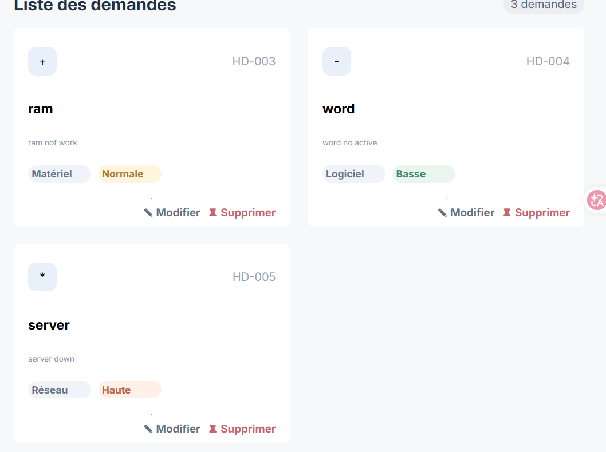
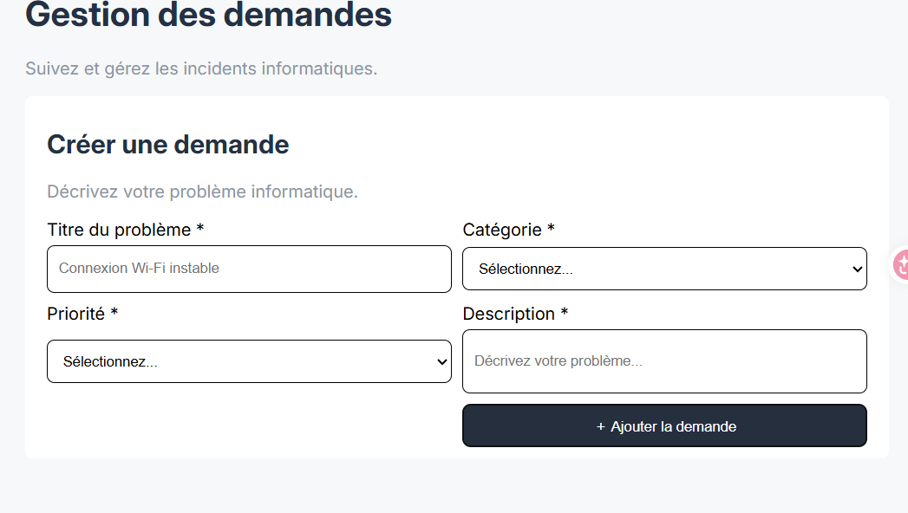
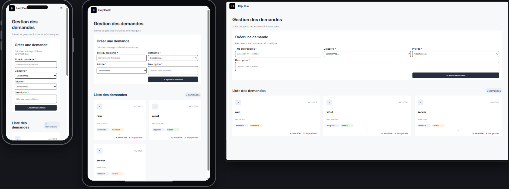

# 🛠️ HelpDesk — Atlas Solutions

## 📌 Description du projet

**HelpDesk** est une application web interactive développée pour **Atlas Solutions**, une entreprise fictive de services numériques.

Cette application permet de centraliser et de gérer les demandes de support informatique signalées par les collaborateurs de l'entreprise.

Les utilisateurs peuvent consulter, ajouter et supprimer des demandes de support à travers une interface simple, moderne et responsive.

Le projet est développé avec **HTML5, CSS3 et JavaScript Vanilla**, sans framework, backend ni base de données.

L'objectif principal est de mettre en pratique la manipulation du DOM, la gestion des événements et l'interaction avec les formulaires en JavaScript.

---

## 🎯 Objectifs du projet

- Créer une application web interactive et responsive.
- Manipuler le DOM avec JavaScript.
- Gérer les événements utilisateur.
- Ajouter et supprimer dynamiquement des demandes.
- Valider les données d'un formulaire.
- Afficher des messages d'erreur et de confirmation.
- Mettre à jour automatiquement le compteur des demandes.
- Organiser le code en fonctions réutilisables.
- Utiliser Git, GitHub et Jira pour la gestion du projet.

---

## ✨ Fonctionnalités

### 📋 1. Consultation des demandes

- Affichage dynamique des demandes de support.
- Présentation des demandes sous forme de cartes.
- Affichage du titre, de la description, de la catégorie et de la priorité.
- Affichage d'un message lorsqu'aucune demande n'existe.

### ➕ 2. Ajout d'une demande

L'utilisateur peut créer une nouvelle demande à travers un formulaire contenant :

- **Titre** : titre du problème informatique.
- **Description** : description détaillée du problème.
- **Catégorie** : Matériel, Logiciel ou Réseau.
- **Priorité** : Basse, Normale ou Haute.

Le formulaire comprend :

- Une validation des champs obligatoires.
- Des messages d'erreur en cas de saisie incorrecte.
- Un message de confirmation après l'ajout.
- Une réinitialisation automatique du formulaire.
- Un ajout dynamique sans rechargement de la page.

### 🗑️ 3. Suppression d'une demande

- Chaque demande possède un bouton « Supprimer ».
- Une confirmation est demandée avant la suppression.
- L'utilisateur peut confirmer ou annuler l'action.
- La liste est actualisée automatiquement après suppression.

### 🔢 4. Compteur dynamique

- Affichage du nombre total de demandes.
- Mise à jour automatique après chaque ajout.
- Mise à jour automatique après chaque suppression.
- Affichage d'un message lorsque la liste est vide.

### ⭐ 5. Fonctionnalités supplémentaires (Bonus)

Les fonctionnalités bonus peuvent inclure :

- 🔍 Recherche des demandes par titre.
- 🏷️ Filtrage par catégorie.
- 🚩 Filtrage par priorité.
- 🔄 Basculement entre vue en cartes et vue en tableau.
- 💾 Sauvegarde des demandes avec localStorage.

---

## 🛠️ Technologies utilisées

| Technologie | Utilisation |
|-------------|-------------|
| HTML5 | Structure et sémantique de l'application |
| CSS3 | Design et mise en page |
| JavaScript Vanilla | Interactivité et manipulation du DOM |
| Flexbox | Organisation des éléments |
| CSS Grid | Mise en page responsive |
| Media Queries | Adaptation aux différentes tailles d'écran |
| Git | Versionnement du code |
| GitHub | Hébergement du dépôt |
| Jira | Organisation et suivi des tâches |
| VS Code | Environnement de développement |

---

## 📁 Structure du projet

```text
helpdesk/
│
├── index.html
│
├── css/
│   └── style.css
│
├── js/
│   └── script.js
│
├── assets/
│   ├── images/
│   └── icons/
│
├── screenshots/
│   ├── dashboard.png
│   ├── formulaire.png
│   └── responsive.png
│
└── README.md
```

### Description des fichiers

- `index.html` : structure principale de l'application.
- `css/style.css` : styles et responsive design.
- `js/script.js` : logique JavaScript et manipulation du DOM.
- `assets/` : images et icônes utilisées.
- `screenshots/` : captures d'écran de l'application.
- `README.md` : documentation du projet.

---

## ⚙️ Fonctionnement de l'application

### 🖥️ Affichage dynamique

JavaScript permet de :

- Parcourir le tableau des demandes.
- Générer les éléments HTML.
- Afficher les demandes dans le DOM.
- Actualiser l'interface sans recharger la page.

### 📝 Gestion du formulaire

Lors de la soumission :

1. JavaScript intercepte l'événement `submit`.
2. `preventDefault()` empêche le rechargement.
3. Les valeurs des champs sont récupérées.
4. Les données sont validées.
5. Une nouvelle demande est créée.
6. La demande est ajoutée au tableau.
7. L'affichage et le compteur sont actualisés.
8. Un message de confirmation apparaît.

### 🗑️ Gestion de la suppression

Lorsqu'un utilisateur clique sur « Supprimer » :

1. Une boîte de confirmation apparaît.
2. Si l'utilisateur confirme, la demande est supprimée.
3. Le tableau JavaScript est mis à jour.
4. La liste et le compteur sont actualisés.

---

## 📱 Responsive Design

L'application utilise une approche **Mobile First** afin de garantir une expérience utilisateur adaptée aux différents appareils.

### Breakpoints

| Appareil | Largeur | Affichage |
|----------|---------|-----------|
| Mobile | < 768px | Interface en une colonne |
| Tablette | ≥ 768px | Interface adaptée |
| Desktop | ≥ 1024px | Interface plus large |

### Adaptations responsive

**Mobile :**
- Formulaire adapté aux petits écrans.
- Cartes affichées en une colonne.
- Boutons accessibles et faciles à utiliser.

**Tablette :**
- Espacements optimisés.
- Grille adaptée à la largeur de l'écran.

**Desktop :**
- Affichage des demandes sur plusieurs colonnes.
- Meilleure utilisation de l'espace disponible.

---

## ♿ Accessibilité

L'application respecte les bonnes pratiques d'accessibilité Web :

- Utilisation des balises HTML5 sémantiques.
- Labels associés aux champs du formulaire.
- Champs obligatoires clairement identifiés.
- Navigation au clavier.
- Focus visible sur les éléments interactifs.
- Contraste suffisant entre le texte et le fond.
- Messages d'erreur compréhensibles.
- Boutons clairement identifiables.

---

## 📊 Gestion de projet avec Jira

Le projet est organisé à l'aide de **Jira**.

Les fonctionnalités sont divisées en User Stories et en tâches.

### Tableau Kanban

Les tâches sont organisées dans quatre colonnes :

- **To Do** : tâches à réaliser.
- **In Progress** : tâches en cours.
- **Done** : tâches terminées.

---

## 🌿 Git et GitHub

Git et GitHub sont utilisés pour assurer le versionnement du projet.


---

## 🧪 Tests réalisés

Les fonctionnalités à vérifier sont :

| Test | Résultat attendu |
|------|------------------|
| Chargement de la page | Affichage des demandes initiales |
| Ajout valide | Nouvelle demande affichée |
| Formulaire vide | Message d'erreur |
| Suppression confirmée | Demande supprimée |
| Suppression annulée | Demande conservée |
| Ajout d'une demande | Compteur augmenté de 1 |
| Suppression d'une demande | Compteur diminué de 1 |
| Liste vide | Message adapté |
| Affichage mobile | Interface responsive |

---

## 🔗 Liens du projet

### 🐙 Repository GitHub

[Voir le code source](https://github.com/ayoubgon/HelpDesk.git)

### 🌐 Site Web — Live Demo

[Voir l'application en ligne](https://helpdesk-livid-two.vercel.app/)

### 📊 Tableau Jira

[Voir le tableau Jira](https://ayoubchwawa.atlassian.net/jira/software/projects/DES/boards/3?filter=assignee+IN+%28712020%3Ad02df2fc-3d16-46cb-8e28-af73c62564c4%2C+empty%29&groupBy=none&atlOrigin=eyJpIjoiMGJmMzE3ZWZmZjNhNGQyMDg1MzI4MWQ2NDU1MGQyZjkiLCJwIjoiaiJ9)

---

## 📸 Captures d'écran

### 🖥️ Interface principale



### 📝 Formulaire d'ajout



### 📱 Version responsive



---

## 🚧 Limites du projet

L'application fonctionne uniquement côté navigateur.

Elle ne possède :

- Aucun serveur backend.
- Aucune base de données.
- Aucune API externe.
- Aucun système d'authentification.

Les demandes sont stockées dans un tableau JavaScript.

Sans sauvegarde avec `localStorage`, les modifications sont perdues lors du rechargement de la page.

---

## 🎯 Conclusion

Le projet **HelpDesk — Atlas Solutions** permet de mettre en pratique les fondamentaux du développement Web Front-End.

Il met particulièrement l'accent sur :

- La manipulation du DOM.
- La gestion des événements JavaScript.
- L'utilisation des tableaux et des objets.
- La validation des formulaires.
- L'affichage dynamique des données.
- Le Responsive Design.
- Le versionnement avec Git et GitHub.
- La gestion des tâches avec Jira.

Ce projet constitue une première étape vers le développement d'applications Web interactives avec JavaScript.

---

## 👨‍💻 Auteur

**Développé par :** [Votre nom]

**Formation :** YouCode

**Année :** 2026

---

© 2026 HelpDesk — Atlas Solutions | Projet pédagogique.